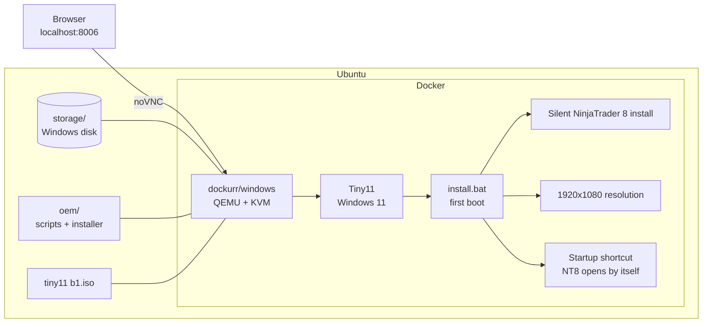

# NinjaTrader 8 on Ubuntu with Docker

Run **NinjaTrader 8** on Ubuntu without installing Windows on your PC or dual booting. One command starts a lightweight Windows VM (Tiny11) inside Docker, installs NinjaTrader unattended, and sets it to launch on its own every time Windows boots. You use it from your browser.


> [!NOTE]
> This is a proof of concept. It is built and tested on an Ubuntu desktop.

## Why use it

- **NinjaTrader opens by itself.** When Windows starts, NinjaTrader 8 launches automatically. Restart the container or your PC and it is open again, with no clicks.
- **Unattended install.** Windows and NinjaTrader install themselves on first boot. No setup wizards, no "Next" buttons.
- **Runs in the browser.** Open `http://localhost:8006` and you get the Windows desktop. No VNC or RDP client needed (RDP is still available if you prefer it).
- **Full HD out of the box.** A startup script sets the resolution to 1920x1080, so there are no black borders in the web viewer.
- **Lightweight.** Tiny11 strips Windows 11 down to the essentials: about 8 GB on disk and comfortable with 2 GB of RAM.
- **Near-native speed.** It uses KVM, the Linux kernel's hardware virtualization, instead of slow emulation.
- **Persistent.** Workspaces, indicators, and settings live in the `storage/` folder and survive restarts and container updates.
- **Isolated.** NinjaTrader runs in its own VM, separate from your Linux system. If something breaks, delete the container and start over.
- **One-click launcher.** `./nt8.sh launcher` adds a **NinjaTrader 8** icon to the Ubuntu app menu. Click it and the VM starts and opens in your browser.
- **Starts with your machine.** With `restart: unless-stopped`, the container comes back up when you turn on your PC.
- **Reproducible.** The whole setup is one `docker-compose.yml` and one `.env` file. Repeat the same install on another computer.

## How it works



1. [`dockurr/windows`](https://github.com/dockur/windows) installs Windows from the Tiny11 ISO inside a QEMU/KVM virtual machine.
2. Everything in the `oem/` folder is copied to `C:\OEM`. When the Windows install finishes, `install.bat` runs.
3. `install.bat` sets the resolution, installs NinjaTrader 8 silently with `msiexec /quiet`, and adds a shortcut to the Windows Startup folder. That shortcut is what makes NinjaTrader open automatically.

## Requirements

| Requirement | Minimum | Recommended |
| --- | --- | --- |
| OS | Ubuntu 22.04 / 24.04 (64-bit) | Ubuntu 24.04 |
| CPU | 2 cores with virtualization (Intel VT-x / AMD-V) | 4 cores |
| Free RAM | 3 GB (2 GB for the VM) | 6 GB or more |
| Free disk | 40 GB | 64 GB on an SSD |
| Internet | To download the ISO (3 GB) and NinjaTrader | |

> [!IMPORTANT]
> Virtualization must be enabled in your BIOS/UEFI (look for *Intel VT-x*, *AMD-V*, or *SVM*). KVM will not work without it.

## About the Tiny11 ISO

This project uses **Tiny11 b1**, a trimmed-down build of Windows 11 made by NTDEV.

| | |
| --- | --- |
| File | `tiny11 b1.iso` |
| Size | 3.0 GB (3,178,233,856 bytes) |
| Based on | Windows 11 Pro 22H2 |
| Disk usage after install | About 8 GB (a standard Windows 11 install takes 20 GB or more) |
| RAM | Runs NinjaTrader with 2 GB assigned to the VM |
| What is removed | Most bundled apps and bloatware, so there is less running in the background |
| Source | [archive.org/details/tiny-11-NTDEV](https://archive.org/details/tiny-11-NTDEV) |
| SHA-1 | `340db8f1018790d00105dfe3e550a34bbc3c597b` |
| MD5 | `efd53d1bd51854ee57391ea3a4700cbf` |

Why Tiny11: NinjaTrader only needs a basic Windows desktop and the .NET Framework. A smaller Windows means a faster first install, a smaller disk, and more RAM left for NinjaTrader and your charts.

> [!CAUTION]
> Tiny11 is an unofficial community build. It is not made or supported by Microsoft, and b1 is a 2023 beta. Always verify the checksum after downloading, and use it for testing or personal setups. You still need a valid Windows license to use Windows.

> [!TIP]
> Prefer not to use a third-party ISO? You can build your own Tiny11 from an official Microsoft ISO with [tiny11builder](https://github.com/ntdevlabs/tiny11builder), or skip the ISO entirely and let dockur download Windows for you (see [Configuration](#configuration)).

## Step-by-step setup on Ubuntu

### 1. Check that your PC supports KVM

```bash
sudo apt update
sudo apt install -y cpu-checker
kvm-ok
```

It should print `KVM acceleration can be used`. If it does not, enable virtualization in your BIOS.

### 2. Install Docker and Docker Compose

```bash
sudo apt install -y docker.io docker-compose-v2 git
sudo usermod -aG docker,kvm $USER
```

Log out and back in (or reboot) so the new groups apply. Then check:

```bash
docker compose version
```

> [!TIP]
> On Ubuntu 22.04 the `docker-compose-v2` package may not exist. In that case, install Docker from the [official guide](https://docs.docker.com/engine/install/ubuntu/), which already includes `docker compose`.

### 3. Get the project

```bash
git clone https://github.com/ArkadCode/ninjatrader8-on-linux.git ninjatrader8-on-linux
cd ninjatrader8-on-linux
```

### 4. Download the Tiny11 ISO

Download it from archive.org (3 GB):

```bash
wget -O ~/Downloads/tiny11-b1.iso "https://archive.org/download/tiny-11-NTDEV/tiny11%20b1.iso"
```

Or open [archive.org/details/tiny-11-NTDEV](https://archive.org/details/tiny-11-NTDEV) and click **22H2 Beta1 download** under *Download Options*.

Verify the file. The output must match exactly:

```bash
sha1sum ~/Downloads/tiny11-b1.iso
# 340db8f1018790d00105dfe3e550a34bbc3c597b
```

> [!WARNING]
> If the checksum is different, delete the file and download it again. Do not use an ISO that does not match.

### 5. Download the NinjaTrader 8 installer

NinjaTrader is proprietary software, so the installer is not included in this repository.

1. Download the `.msi` installer from [ninjatrader.com](https://ninjatrader.com/) (downloads section, free account required).
2. Put it in the `oem/` folder with this exact name:

```bash
mv ~/Downloads/NinjaTrader.Install.msi oem/NinjaTrader.Install.Previous.msi
```

The folder should look like this:

```text
oem/
├── install.bat
├── setres.ps1
└── NinjaTrader.Install.Previous.msi
```

### 6. Set your password and ISO path

```bash
cp .env.example .env
nano .env
```

Change at least these two values:

```ini
WIN_PASSWORD=your-own-password
WIN_ISO=/home/your-user/Downloads/tiny11-b1.iso
```

`WIN_ISO` must be an absolute path. You can adjust RAM, CPU, and disk size to fit your machine.

### 7. Start it

```bash
docker compose up -d
```

To follow the progress:

```bash
docker logs -f nt8
```

### 8. Open NinjaTrader in your browser

Go to **http://localhost:8006**.

- On the **first run** you will watch Windows install itself. This takes 10 to 20 minutes depending on your disk. Then `install.bat` runs and installs NinjaTrader (about 2 more minutes).
- When it is done, a console window shows `Proceso completado!` ("Process completed"). You can close it.
- **From then on**, every time the container starts, Windows logs in and NinjaTrader opens by itself within a minute or two.

> [!NOTE]
> The setup script only runs during the first Windows install. If you change anything in `oem/` later, delete `storage/` to reinstall from scratch (you will lose everything inside the VM).

## Daily use

The `nt8.sh` helper wraps the common tasks. Give it permission to run once:

```bash
chmod +x nt8.sh
```

| Task | Command |
| --- | --- |
| Start and open in the browser | `./nt8.sh open` (or the **NinjaTrader 8** app menu icon) |
| Shut Windows down safely | `./nt8.sh stop` |
| Check status | `./nt8.sh status` |
| View logs | `./nt8.sh logs` |
| Add the **NinjaTrader 8** icon to the app menu | `./nt8.sh launcher` |
| Reinstall from scratch | `docker compose down && sudo rm -rf storage/ && docker compose up -d` |

**RDP (optional):** with Remmina, which ships with Ubuntu, connect to `localhost:3389` using the user and password from your `.env`. It usually feels smoother than the browser.

## Project structure

```text
.
├── docker-compose.yml   # Windows VM definition (resources, ports, volumes)
├── .env.example         # Settings template: copy to .env
├── nt8.sh               # Daily helper: start, stop, open, status, logs
├── oem/
│   ├── install.bat      # Runs on first boot: installs NT8 and sets up autostart
│   └── setres.ps1       # Forces the resolution to 1920x1080
└── storage/             # Created automatically: Windows virtual disk (not committed)
```

## Configuration

All settings live in `.env`:

| Variable | Default | Description |
| --- | --- | --- |
| `WIN_USER` | `trader` | Windows user name |
| `WIN_PASSWORD` | *(required)* | Windows password |
| `WIN_ISO` | *(required)* | Absolute path to the Tiny11 ISO |
| `RAM_SIZE` | `2G` | Memory for the VM. Use `4G` or more for many charts or strategies |
| `CPU_CORES` | `2` | CPU cores for the VM |
| `DISK_SIZE` | `32G` | Maximum size of the virtual disk |
| `BIND_IP` | `127.0.0.1` | Where the VM can be reached from. `127.0.0.1` means this PC only |
| `WIN_VERSION` | `11l` | Only used without a custom ISO (see below) |

### Without the ISO

If you would rather not download an ISO, delete the `/custom.iso` line in `docker-compose.yml` and set `WIN_VERSION` in `.env`. dockur will download Windows for you. Some [available versions](https://github.com/dockur/windows#how-do-i-select-the-windows-version):

| `WIN_VERSION` | Edition | Download size |
| --- | --- | --- |
| `core11` | Tiny11 Core | 3.0 GB |
| `tiny11` | Tiny11 | 5.3 GB |
| `11l` | Windows 11 LTSC | 4.7 GB |
| `11` | Windows 11 Pro | 7.9 GB |

### Change the resolution

Edit the last line of [`oem/setres.ps1`](oem/setres.ps1):

```powershell
[Display]::ChangeResolution(2560, 1440)
```

## Troubleshooting

| Problem | Fix |
| --- | --- |
| `KVM acceleration can NOT be used` | Enable virtualization in the BIOS |
| `permission denied` on `/dev/kvm` | Run `sudo usermod -aG kvm $USER` and log in again |
| `Set WIN_PASSWORD in the .env file` | You have not created `.env`. Run `cp .env.example .env` |
| `Set WIN_ISO in the .env file` | Add the absolute path to the ISO in `.env`, or remove the ISO line (see [Without the ISO](#without-the-iso)) |
| Windows does not install, or `/custom.iso` is a folder | The `WIN_ISO` path is wrong. Docker creates an empty folder when the file does not exist. Fix the path and run `docker compose down && docker compose up -d` |
| NinjaTrader was not installed | Check the log inside Windows at `C:\NT8_install.log`, and make sure the `.msi` in `oem/` has the exact name |
| Windows feels slow | Raise `RAM_SIZE` and `CPU_CORES` in `.env` and run `docker compose up -d` |
| Black borders in the browser | Check that `setres.ps1` ran, or change the resolution inside Windows |

## Credits

- [dockur/windows](https://github.com/dockur/windows): Windows inside Docker with QEMU/KVM.
- [Tiny11](https://archive.org/details/tiny-11-NTDEV) by NTDEV and [tiny11builder](https://github.com/ntdevlabs/tiny11builder).
- [NinjaTrader](https://ninjatrader.com/): trading platform. This project is not affiliated with NinjaTrader or Microsoft. Each user must download the software and accept its license, as well as the Windows license.
